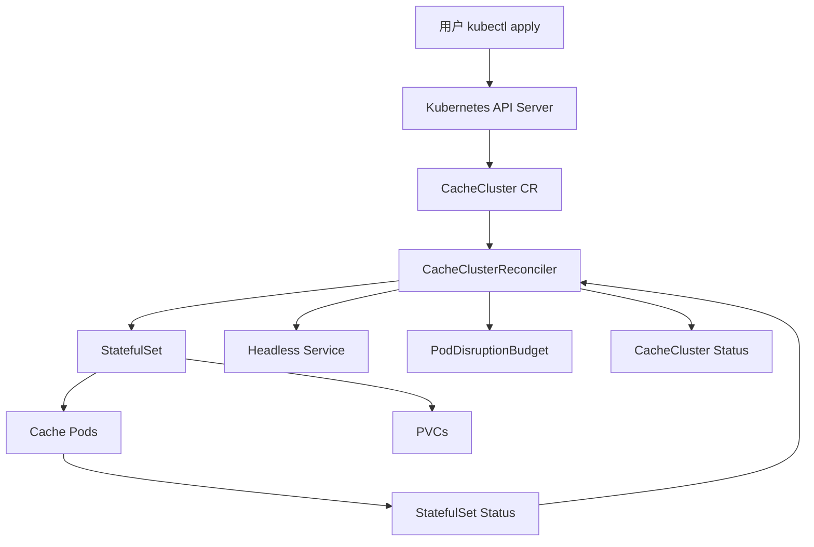
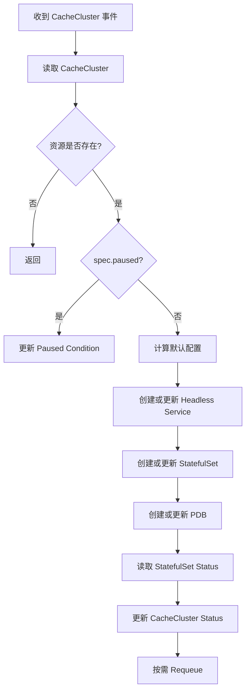

# CacheCluster Operator 设计文档

## 1. 设计目标

本设计实现一个最小但完整的 Kubernetes Operator：通过 `CacheCluster` 自定义资源管理缓存实例的 StatefulSet、Headless Service 和 PodDisruptionBudget，并将底层资源状态汇总回 `CacheCluster.status`。

设计优先保证：

- 声明式：用户只修改自定义资源的 Spec。
- 可重复执行：Reconcile 多次执行不会产生重复资源。
- 可观测：Status、Condition、Event 和日志能够说明当前进度。
- 可测试：资源构造逻辑和控制循环可以脱离真实业务缓存服务测试。
- 可扩展：后续可以增加备份、监控和外部 HA 集成。

## 2. 总体架构



组件职责：

| 组件 | 职责 |
| --- | --- |
| `CacheCluster` CRD | 定义用户可声明的缓存集群 API |
| `CacheClusterReconciler` | 比较期望状态和实际状态并执行修正 |
| StatefulSet | 管理稳定网络标识、Pod 副本和存储声明 |
| Headless Service | 为 StatefulSet Pod 提供稳定 DNS |
| PVC | 为每个实例提供独立持久化卷 |
| PDB | 限制自愿驱逐时同时不可用的 Pod 数量 |
| Status | 向用户反馈当前阶段、就绪副本和 Condition |

## 3. API 设计

### 3.1 Group、Version、Kind

```text
Group:   cache.example.com
Version: v1alpha1
Kind:    CacheCluster
Plural:  cacheclusters
```

Go 类型建议：

```text
api/v1alpha1/cachecluster_types.go
```

### 3.2 Spec

```go
type CacheClusterSpec struct {
    // +kubebuilder:validation:Minimum=1
    // +kubebuilder:default=1
    Replicas *int32 `json:"replicas,omitempty"`

    // +kubebuilder:default="redis:7"
    Image string `json:"image,omitempty"`

    Storage StorageSpec `json:"storage,omitempty"`

    // +optional
    Resources corev1.ResourceRequirements `json:"resources,omitempty"`

    // +optional
    Paused bool `json:"paused,omitempty"`
}

type StorageSpec struct {
    // +kubebuilder:default="1Gi"
    Size resource.Quantity `json:"size,omitempty"`

    // +optional
    StorageClassName *string `json:"storageClassName,omitempty"`
}
```

实际实现时应根据 Kubebuilder 版本选择默认值表达方式，并通过 `make generate` 和 `make manifests` 生成代码与 CRD 校验规则。

### 3.3 Status

```go
type CacheClusterStatus struct {
    Phase              string             `json:"phase,omitempty"`
    Replicas           int32              `json:"replicas,omitempty"`
    ReadyReplicas      int32              `json:"readyReplicas,omitempty"`
    ObservedGeneration int64              `json:"observedGeneration,omitempty"`
    Conditions         []metav1.Condition `json:"conditions,omitempty"`
}
```

Condition 类型约定：

| Type | True 的含义 |
| --- | --- |
| `Ready` | 所有期望副本已经就绪 |
| `Progressing` | 正在创建或更新底层资源 |
| `Degraded` | 资源存在异常，需要人工关注 |

## 4. 资源命名与归属

建议使用 CacheCluster 名称作为主要资源名称：

```text
CacheCluster: demo-cache
StatefulSet:  demo-cache
Service:      demo-cache
PDB:          demo-cache
```

所有由 Operator 创建的资源都必须：

1. 使用 CacheCluster 所在 Namespace。
2. 设置 `controllerutil.SetControllerReference`。
3. 添加推荐标签：
   - `app.kubernetes.io/name: cache-operator`
   - `app.kubernetes.io/instance: <cachecluster-name>`
   - `app.kubernetes.io/managed-by: cache-operator`
   - `cache.example.com/cluster: <cachecluster-name>`

OwnerReference 使 Kubernetes 在删除 CacheCluster 时自动清理从属资源，也让 Controller 能通过 owner 关系监听相关事件。

## 5. Reconcile 流程



推荐的 Reconcile 步骤：

1. 使用 `r.Get` 读取 `CacheCluster`。
2. 如果对象已删除，直接返回；OwnerReference 负责清理子资源。
3. 如果 `spec.paused=true`，只更新暂停状态并返回。
4. 计算默认副本数、镜像和存储配置。
5. 使用 `controllerutil.CreateOrUpdate` 创建或更新 Service。
6. 使用 `controllerutil.CreateOrUpdate` 创建或更新 StatefulSet。
7. 使用 `controllerutil.CreateOrUpdate` 创建或更新 PDB。
8. 读取 StatefulSet 当前状态。
9. 使用 `meta.SetStatusCondition` 更新 Conditions。
10. 使用 `r.Status().Update` 更新 CacheCluster Status。
11. 对正在变化的资源返回短暂 Requeue；稳定状态返回 nil。

所有资源更新逻辑必须是幂等的。不要每次 Reconcile 都无条件修改 Pod 模板或生成随机值，否则会造成不必要的滚动更新。

## 6. StatefulSet 设计

StatefulSet 负责运行缓存实例。核心配置如下：

- `spec.serviceName` 指向 Headless Service。
- `spec.replicas` 来自 `CacheCluster.spec.replicas`。
- `spec.selector` 与 Pod Template 标签完全匹配。
- `spec.template.spec.containers[0].image` 来自 `CacheCluster.spec.image`。
- `spec.template.spec.containers[0].resources` 来自 `CacheCluster.spec.resources`。
- `volumeClaimTemplates` 根据存储配置创建 PVC。
- 设置就绪探针和存活探针，避免只根据 Pod Running 判断实例健康。

MVP 阶段可以使用简单的 TCP 探针或缓存镜像提供的健康命令。若镜像不提供可靠的健康命令，应在文档中明确这是演示实现，不代表生产级缓存健康检查。

示意结构：

```yaml
apiVersion: apps/v1
kind: StatefulSet
metadata:
  name: demo-cache
spec:
  serviceName: demo-cache
  replicas: 3
  selector:
    matchLabels:
      cache.example.com/cluster: demo-cache
  template:
    metadata:
      labels:
        cache.example.com/cluster: demo-cache
    spec:
      containers:
        - name: cache
          image: redis:7
          ports:
            - name: cache
              containerPort: 6379
          resources: {}
  volumeClaimTemplates:
    - metadata:
        name: data
      spec:
        accessModes: ["ReadWriteOnce"]
        resources:
          requests:
            storage: 1Gi
```

## 7. Service 设计

使用 Headless Service：

```yaml
spec:
  clusterIP: None
  publishNotReadyAddresses: false
```

它提供稳定 DNS：

```text
<statefulset-name>-0.<service-name>.<namespace>.svc
<statefulset-name>-1.<service-name>.<namespace>.svc
```

MVP 阶段不额外创建读写分离 Service，因为项目不实现主从选举和角色识别。后续集成 Sentinel 或其他 HA 组件时，再根据角色创建读写 Service。

## 8. PodDisruptionBudget 设计

当副本数大于 1 时创建 PDB，建议使用：

```yaml
spec:
  maxUnavailable: 1
```

当副本数为 1 时，是否创建 PDB 需要谨慎；为了避免阻塞节点维护，可以在 MVP 阶段不创建单副本 PDB，或通过配置明确允许单副本被驱逐。

PDB 只能限制自愿驱逐，不能阻止节点宕机，也不能提供数据复制或故障切换能力。

## 9. Status 更新策略

Status 更新应避免无意义的 API 写入：

1. 从 StatefulSet 读取 `replicas`、`readyReplicas` 和 `updatedReplicas`。
2. 根据值计算 Phase。
3. 只有 Status 内容实际变化时才调用 `Status().Update`。
4. 设置 `observedGeneration=metadata.generation`。
5. Condition 的 `LastTransitionTime` 只在状态真正变化时更新。

建议的 Phase 判定：

```text
CacheCluster 不存在       -> 不处理
期望副本为 0              -> 不允许，通过 CRD 校验拒绝
readyReplicas == replicas -> Running
存在创建或滚动更新         -> Pending
长时间未就绪或错误          -> Degraded
```

## 10. 事件监听与 Requeue

Controller 至少监听：

- `CacheCluster` 主资源。
- 由 CacheCluster 控制的 StatefulSet。
- 由 CacheCluster 控制的 Service。
- 由 CacheCluster 控制的 PDB。

当 StatefulSet 状态变化时，应触发 CacheCluster Reconcile，以便及时更新 Status。关联资源应使用 `Owns(&appsv1.StatefulSet{})` 等方式注册。

对于临时未就绪状态，可以返回 `RequeueAfter`，但不应使用过短的固定周期造成 API Server 压力。底层资源事件通常优先于高频轮询。

## 11. 权限设计

Controller 需要通过 RBAC 访问：

- `cacheclusters.cache.example.com`：get、list、watch、create、update、patch、delete。
- `cacheclusters/status`：get、update、patch。
- `cacheclusters/finalizers`：update。
- `apps/statefulsets`：get、list、watch、create、update、patch、delete。
- `core/services`：get、list、watch、create、update、patch、delete。
- `policy/poddisruptionbudgets`：get、list、watch、create、update、patch、delete。
- 相关资源的 events：create、patch。

权限应通过 Kubebuilder RBAC markers 生成，不手工维护重复的 ClusterRole 规则。

## 12. 测试设计

### 12.1 单元测试

测试资源构造函数：

- 默认副本数和镜像是否正确。
- StatefulSet 的 selector 和 Pod 标签是否匹配。
- Service 是否为 Headless Service。
- PDB 是否只在预期条件下创建。
- OwnerReference 是否设置正确。

### 12.2 Reconciler 测试

使用 fake client 或 envtest 测试：

- 创建 CacheCluster 后产生底层资源。
- 修改副本数后 StatefulSet 更新。
- 修改镜像后 Pod Template 更新。
- StatefulSet 就绪后 Status 更新为 Running。
- `paused=true` 时跳过业务资源变更。
- 删除主资源后底层资源清理或进入删除流程。

### 12.3 集群验证

在 K3s 或 kind 中执行：

```bash
make install
make deploy IMG=<registry>/cache-operator:dev
kubectl apply -f config/samples/
kubectl get cacheclusters
kubectl get statefulsets,svc,pdb,pods
kubectl describe cachecluster <name>
```

## 13. 发布与部署流程

本地开发阶段：

```bash
make generate
make manifests
go test ./cmd ./test/utils
```

集群部署阶段：

```bash
make docker-build docker-push IMG=<registry>/cache-operator:tag
make install
make deploy IMG=<registry>/cache-operator:tag
```

卸载顺序：

```bash
kubectl delete -k config/samples/
make uninstall
make undeploy
```

## 14. 失败处理与可观测性

Reconcile 遇到 API 错误时：

- 返回错误，让 controller-runtime 使用退避策略重试。
- 记录资源命名空间、名称和错误原因。
- 更新 `Degraded=True` 或 `Progressing=True`，但避免在错误循环中频繁写 Status。
- 不删除现有可用资源来“强制重建”，除非明确设计了恢复策略。

日志应至少包含：

```text
namespace
name
resource kind
operation
reason
error
```

## 15. 后续演进

完成 MVP 后，可以按以下顺序扩展：

1. 完善 Conditions 和事件。
2. 增加 Webhook 默认值和校验。
3. 增加备份 CronJob 和备份状态。
4. 引入 Redis Sentinel 或其他现成 HA 机制。
5. 根据缓存角色创建读写 Service。
6. 增加 Prometheus 指标和 ServiceMonitor。
7. 增加 API version 升级和转换 webhook。

Operator 的职责应保持在“声明状态、编排资源、观察状态和执行运维动作”范围内，不应把缓存协议本身重新实现一遍。
